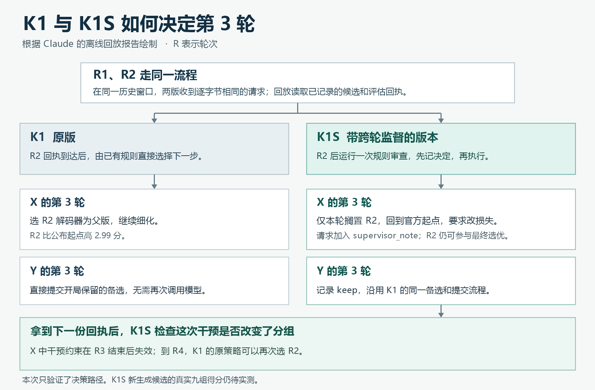

# Claude 的 K1S 监督 Harness 报告｜中文全译

以下是 Claude 的报告。R1、R2、R3 分别指第一、第二、第三轮。“父版”指本轮生成候选时作为起点的代码。“九格”指三个算例各取三个种子形成的九个评估单元。文末有一条关于翻层统计的译注。

## 离线回放得到了什么结果

把实验 X 前两轮记录交给 K1，K1 会在第三轮以 R2 为父版继续细化。带监督的版本 K1S 会在这一轮排除 R2，回到官方初始程序，并要求改动损失函数。两个版本前两轮收到的请求逐字节相同。换成实验 Y 的前两轮记录，K1S 保留了 K1 的决定。

我将历史 R1、R2 的候选和评估回执分别送入两个 Agent，离线验证了上述行为。这次没有调用模型、使用 GPU 或执行新的物理评估，K1S 对分数的影响仍待验证。

### 实验 X

没有监督的 K1 会在 R3 对 R2 执行 `refine_incumbent`，即沿当前最好候选继续细化。R2 的解码器比起点高 2.99 分。K1 把整体上下层互换也计作分层发生变化，因此 R2 看起来取得了值得延续的改进。K1S 只干预 R3 这一步，R2 仍有资格参与最终选优。

- **发现。** 按 Claude 原文的统计，R2 九格里有七格保留了初始分组或将其整体翻转。其中四个翻转格的分差合计为 +38.26，其余五格合计为 −11.31。这是逐格分差之和；九格平均后约为 +2.99。对“完全翻转”的核对见文末译注。
- **决策。** 本轮暂时搁置 R2。K1 原有策略随后选中官方起点，进入探索不同方案的 `diversify` 步骤，并要求修改损失函数。
- **模型将看到什么。** 第三轮拟发送的请求增加一个 `supervisor_note` 字段，写入上述证据，以及 R1 新损失项仅占总损失 0.37% 的观察。
- **怎样验收。** 收到下一轮回执后，记录程序是否真正改变了分组。若把 X 历史上真实发生的 R3 回执交给这项检查，它会记为“九格全部发生重分组，得分 23.39，收益集中在一格”。23.39 是这次检查使用的历史样本分。

### 实验 Y

Y 的开局顺序是先改解码器。在离线回放里，K1 和 K1S 都会直接提交开局时保留的备选方案，无需再次调用模型。监督器在日志中记录 `keep`，即维持原决定。

## 一、用 R3 至 R10 复核原先的答卷

我在打开完整包之前已保存答卷并计算哈希，但这次不能算严格盲测。回执暴露了运行名称，我记得后来发生的事，也提前看过另一会话的报告。两套答卷都建议调整新损失项的强度做受控实验。两次历史运行都没有做答卷提出的那项剂量实验，其实际得分未知。

**后来仍站得住的判断**

- 对 X，R2 的表面收益主要与上下层互换有关，X 原来的 Harness 也这样归类。Claude 判断，R1 新损失项太弱，没能有效推动标签变化；后来把它提高到原来的 1.5 倍，仍未见明显作用。
- 对 Y，选 R2 作父版这一判断与 Y 原 Harness 的实际选择一致，后续有了同机父版可供比较。Claude 认为先前看见的 bp“收益”来自机器差异。R2 至 R10 的候选都没有大幅重分组，实例换层比例最高也只有 0.30%。

**现在会修正的判断**

- X 历史上真实的 R3 满足我原先提出的换层幅度和割网标准，但九格里仍有六格掉分，收益集中在一格。验收还应检查最终时序，并单列“去掉贡献最大的一格后，结论是否还成立”。
- 重新看 Y，我会把“搜索过程中没有机制促成实质性重分组”列为首要问题，比我先前指出的反馈表述问题更重要。

## 二、原 K1 是否已经有跨轮监督

没有。K1 的开局复核读不到物理回执，代码位于 `agent.py` 第 591–628 行。它依靠规则选择下一步，逻辑位于 `search_policy.py` 第 252–347 行，由 `agent.py` 第 445 行调用。没有一个角色能同时看到实际请求、模型回复、代码差异和完整回执，K1 本身也不记录请求和回复。

缺失的步骤位于“读完 R2 回执”与“决定 R3 做什么”之间。前者在 `agent.py` 第 416–419 行，后者在第 445 行。K1S 把监督检查加在这两处之间。

## 三、主对话怎样从 33.91 走到 41.73

后面两次提分都曾在物理运行前得到预测。开发者用离线回放发现，新代码的分层标签与这台笔记本上某些已测标签一致，而在这些已测条件下，相同标签复现了相同的时序结果。

- **升到 39.68。** `variance_guard` 在 ariane/1001 上提高约 51.9 分，却在 ariane/1003 上损失约 47.6 分。两个种子的聚类分离度相当于 3.33 和 2.93 个簇内半径。把判断门槛放在 3 个半径，使两个种子各走此前实测较优的分支。
- **升到 41.73。** 一次改动使 bp_fe/1003 的面积平衡误差下降 85%，物理得分却从 51.51 跌到 43.07。下一次实验利用了两条开发证据：九个超节点占 bp_fe 总面积的 75.4%，以及 11 月 16 日已经测过官方分组交换上下层后的表现。由此预估九格均分为 41.7328，后来实测吻合。总分增加的约 2.05 分来自对 bp_fe 所用分层及其朝向的选择。

Harness 可以借鉴的做法是，先看各个种子的得失，再解释净收益；用最终物理时序检验割网、面积等中间指标。开发工作还使用了存好的嵌入、其他日期的回执、单格探测和远超十次的评估机会。正式训练可用的条件更有限。

截至报告取样时，公开验证里完成的两格得 −29.38 和 −100，两格都来自同一个设计。其余四格尚未完成，也缺少同机初始分及实际触发哪个分支的记录。41.73 证明了开发者在这台机器的训练集上取得改进；泛化能力仍待核验。

## 四、实现改了什么

补丁涉及三个文件：新增 `supervisor.py`，在 `agent.py` 增加 86 行、删除 8 行，在 `search_policy.py` 增加 7 行、删除 4 行。

监督器不调用模型，前两轮流程保持一致。每次监督决定都先记日志再生效，重启后不会重复执行。干预只持续一步。在 X 中到第 4 轮，K1 又会沿 R2 的解码器继续改。可以在 R4、R6、R8 再设置规则检查点，无须增加模型调用费用；Claude 建议把这种持续监督作为单独一组实验。

## 五、怎样判断是否值得用

Claude 建议在同型号 GPU 上做成对交叉实验，两版交换机器。两边使用同一起点、同一模型、每次十个提交名额和十五元预算，并保留 K1 仅在首次请求投放专家知识的规则。两边都不注入 41.73 版的代码或其门槛数值。记录四类结果：

1. 第几轮首次超过本机实测的官方起点。
2. 三种层次的重复次数：代码相同、标签完全相同、允许全局翻转后分组相同。
3. 最佳完整九格分数。
4. bp-ng45 改善了多少，同时 bp_fe 和 ariane 各付出多少代价。

历史运行的模型费用为 0.8–1.5 元，K1S 没有增加模型调用。Claude 粗估，要识别 3 分左右的差距，可能需要 15–20 对运行。他建议先免费回放所有已归档的前两轮窗口，再做三对真实试跑。如果多数回放都无法把现象归因于当轮改动，或者每一对实测里 K1S 都落后，他会放弃这个版本。

## 六、另行发现的 K1 缺陷与测试结果

安装 NumPy 时，K1 的解码器探针会误拒 Y 历史上真实运行过的首轮解码器，报错为 `KeyError: '__import__'`。只改一个词即可修复，补丁在 `patches/shared-K1-probe-fix.diff`。Claude 建议两组在 A/B 前都应用这个修复。

|测试套件|Python 3.8，无 NumPy|Python 3.12，有 NumPy|
|---|---|---|
|K1S 新增的 17 项测试|15 项通过，2 项仅适用于 NumPy 环境，跳过|17 项通过|
|在 K1S 上运行 K1 原有的 19 项测试|18 项通过，1 项失败|18 项通过，1 项失败|
|在 K1S 上运行更早的 22 项搜索测试|21 项通过，1 项跳过|22 项通过|

那项失败的 K1 测试检查 `search_policy.py` 是否完全没改；K1S 有意改动了它，因此这项原版范围检查报错。把 K1S 补丁应用到 K1，可逐字节复现 K1S。包里的 `verify.py` 也复核了主对话四版代码的成绩。

Claude 报告产物归档为 `claude-supervisor-audit.zip`。服务器目录为 `/root/code/task2-supervisor-audit/`，内有 `REPORT.md`、`examples/round3-side-by-side.html`、`patches/K1-to-K1S.diff` 和 `blind-sheets/`。Claude 表示也可以将并排对照页面发布为私有分享链接。

## 译注：完全翻转与近似翻转

Claude 原文把 X 的七格写成“原分组或其完全反转”。本地保存的 X 第 2 轮逐格表中，有三格的标签完全相同；另四格绝大多数标签反转，但将上下层对调后仍分别差 1、1、1、2 个实例。用“分组基本相同，主要变化是整体朝向”更准确。这里的核对针对该份历史回执；K1S 的代码与测试结果来自 Claude 自述。
