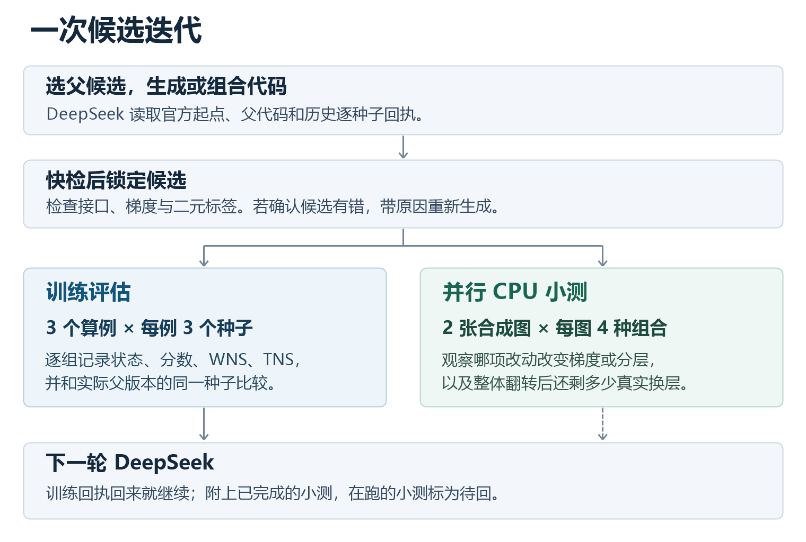
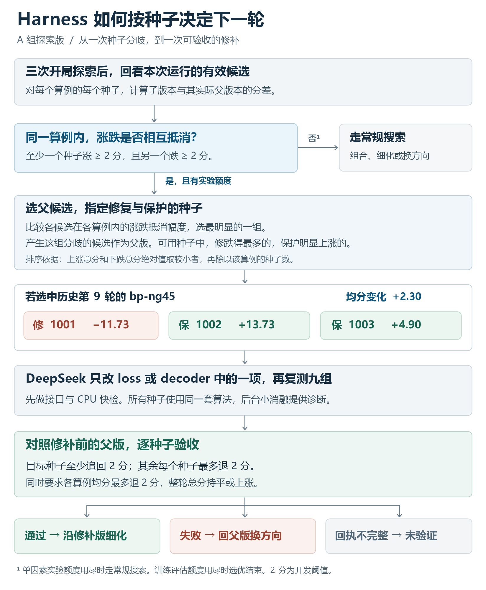

# A 组 Harness 的一轮迭代

DeepSeek 在规划、写代码和缩短请求重试时都能看到同一份逐种子记录。有互补证据时，Harness 也能直接组合两个测过的组件。若遇到可重试的环境故障，则沿用原候选。训练预算用完后按已有规则选优。

## 算例均分持平时，下一轮怎么选

Harness 先把同一候选和其实际父候选按「算例、种子」配对。在一个算例内，只要有种子上涨至少 2 分、同时有另一个下跌至少 2 分，就记录这种相互抵消的变化。这个 2 分沿用开发版实验阈值，官方计分公式保持原样。

例如，历史第 9 轮的 bp-ng45 算例均分提高了 2.30 分，拆开后 1001 跌了 11.73 分，1002 涨了 13.73 分，1003 涨了 4.90 分。这给出了一个有明确目标的实验方向，即修复 1001、同时保住 1002 和 1003。所有种子共用同一套算法。 [第 9 轮回执](../exports/2026-11-19-claude-expert-audit/runs/15332-claude-original-34/round-09/receipt.json)

1. 三次开局探索完成后，在本次运行的有效回执中找这种分歧，包括较早的候选。用同一算例内上涨、下跌两边抵消的幅度排序，在现有单因素实验预算内选择。可确认分层完全相同却时序不同的格会保留诊断标记，单凭这类波动不触发算法修补。
2. 用产生分歧的候选做父版本，选该算例里下跌最多的可用种子作为修复目标，把已明显上涨的同算例种子列入保护清单。DeepSeek 只改一个组件。
3. 九组重新跑完后，对照修复前的父版本。目标种子要追回至少 2 分，其他每个种子都不能退超过 2 分，并沿用已有的整轮得分等检查。即使算例均分上涨，只要把损失转移到另一个种子并超过阈值，这次修补也会判为失败。这是搜索过程的验收，最终仍按既有的完整训练矩阵选择规则选优。

## 一轮九组，逐个种子看

下面是历史回执的开发回放。第 4 轮得到 **34.75 分**，实际父候选是第 2 轮的 **29.43 分**。九组全部成功。Δ 为相同算例、相同种子的子版减父版。WNS 与 TNS 都以 ns 计，Δ 为正表示对应时序指标改善。

| 训练算例 | 种子 | 本轮分数 | Δ 分数 | WNS | Δ WNS | TNS | Δ TNS |
| --- | ---: | ---: | ---: | ---: | ---: | ---: | ---: |
| bp_fe-ng45 | 1001 | 55.81 | +7.70 | -0.6261 | +0.0583 | -195.65 | +61.03 |
| bp_fe-ng45 | 1002 | 54.06 | +12.01 | -0.6583 | +0.1122 | -199.47 | +83.91 |
| bp_fe-ng45 | 1003 | 56.09 | 0 | -0.6029 | 0 | -204.56 | 0 |
| bp-ng45 | 1001 | -15.37 | 0 | -7.8251 | 0 | -8746.73 | 0 |
| bp-ng45 | 1002 | -49.25 | -19.51 | -7.8256 | +0.0356 | -12485.54 | -2171.84 |
| bp-ng45 | 1003 | -1.38 | 0 | -7.9314 | 0 | -7147.70 | 0 |
| ariane133-ng45 | 1001 | 82.97 | +47.75 | -0.2175 | +0.3142 | -0.94 | +38.56 |
| ariane133-ng45 | 1002 | 72.42 | 0 | -0.2499 | 0 | -13.96 | 0 |
| ariane133-ng45 | 1003 | 57.44 | 0 | -0.4498 | 0 | -13.74 | 0 |

三个种子取得正收益，一个退步，五个与父版持平。最大收益来自 ariane133-ng45 / 1001。bp-ng45 / 1002 的 WNS 改善约 0.0356 ns，累计违例 TNS 却恶化约 2171.84 ns。同一算例的另外两个种子持平，因此没有证据将这次退步推广到整个 bp 算例。 [原始回执](../exports/2026-11-19-claude-expert-audit/runs/15332-claude-original-34/round-04/receipt.json)

### DeepSeek 收到的逐种子信息

- 本次运行的每轮候选都有一张 seed_results 表，所有排定的算例和种子各占一行。状态、有效性、分数、WNS、TNS 和相对实际父候选的变化放在同一行。起点有参考测量时，还给出同格相对起点的变化，起点表注明测量来源。历史回放数据只在本地测试中使用。
- 有记录时，同一行还带 WNS/TNS 在分数下限截断前的贡献、修复前后割数、原始和剔除整体翻转后的换层变化、宏单元与面积误差，以及失败阶段和日志摘录。
- 缺少回执的格标为 missing；失败格保留实际状态及可用诊断。未测指标留空，全轮都缺失的可选指标省略整列。观测到的零保留为 0。

## CPU 小测如何提供额外证据

快检对实际父版与候选使用相同输入，检查有限标量损失、梯度与非空二元分层。候选单独违反接口时，把具体原因反馈给生成环节。依赖不足、对照本身失败或超时时，标明诊断条件不足。

后台消融在有空闲 CPU 时并行进行。合成种子 17 和 29 分别产生 40 个等面积组和 56 个面积不均的组；每张图比较对照、只换 loss、只换 decoder、两者都换。单项改动以实际父候选为对照，组合实验以官方起点为对照。相同的函数组合复用同一次计算。

| 合成种子 | 分组数 | 换层组数（校正整体翻转） | 对照边界内换层 | 原始加权割，父 → 子 |
| ---: | ---: | ---: | ---: | ---: |
| 17 | 40 | 18 | 7 / 10 | 23.80 → 17.54 |
| 29 | 56 | 26 | 5 / 14 | 30.61 → 31.23 |

这两行来自第 4 轮代码与其实际父候选的小测。边界组取离两分区面积加权中心的距离差最小的四分之一组。加权割在两种输入上的变化方向不同。CPU 小测衡量修复前的分层行为，真实时序看上面的训练回执。

CPU 小测需要 PyTorch、NumPy 和官方 Place-3D 源码，可用 AICOMP_PROBE_PYTHON 指向已有测试解释器。同一时间只运行一个后台消融，忙碌时会在日志记录。
